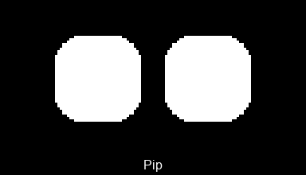

# Pip — an ESP32 desk robot with animated eyes 🤖

Pip is an **ESP32 + 128×64 OLED** showing **procedurally animated eyes**, driven by
**Claude Code** (over MCP) or a local **Ollama** chat. No board? It runs the same face in a
desktop window.

<p align="center"></p>
<p align="center">
  
  
</p>
<p align="center"></p>

## Use Pip in Claude Code

One command adds Pip to every project — no checkout needed. Pick one:

```bash
# With an ESP32 — eyes on the real OLED, over Bluetooth
claude mcp add esplink-buddy --scope user -- \
  uvx --from git+https://github.com/HamzaYslmn/esplink-mcp-robot esplink-buddy

# Without hardware — eyes in an on-screen OLED window
claude mcp add esplink-buddy --scope user -- \
  uvx --from git+https://github.com/HamzaYslmn/esplink-mcp-robot esplink-buddy --emulate
```

Claude Code then calls Pip's `face` tool as it works (pass any mood, activity, vibe or widget
name; an optional one-shot gesture plays over it), so the eyes react live while you code. `face`
and `notify` are pre‑allowed in `.claude/settings.json`. With a board attached, every esplink
peripheral (GPIO, ADC, PWM/servo, I²C, Wi‑Fi, …) is there too as `board_*` tools on Pip's own
Bluetooth link — those ask first (add `"mcp__esplink-buddy__*"` to pre‑approve moving hardware).

> Working inside this repo? Just open it in Claude Code and approve the checked‑in `.mcp.json`.

## Flash the ESP32 (once)

Needs a **classic ESP32** or an **ESP32‑S3** (`esplink flash` picks the right image from the USB ID), a
**128×64 I²C OLED** (SSD1306/SH1106), and [uv](https://docs.astral.sh/uv/).

```bash
uv sync                  # install deps — Python ≥3.13
uv run esplink flash     # flash firmware over USB (once) — pick the port
uv run esplink -b info   # unplug USB, confirm Bluetooth reaches the board
uv run esplink -b set-name pip   # optional: name it, then ROBOT_BLE_TARGET=pip picks it among several
```

Wire the OLED **VCC→3V3, GND→GND, SDA→GPIO1, SCL→GPIO2** (classic ESP32: GPIO1 is its USB
serial TX, so use 21/22 and set `ROBOT_OLED_SDA=21` / `ROBOT_OLED_SCL=22`). The default Bluetooth password
`esplink` matches Pip's defaults — nothing to configure.

<details><summary>Prefer the Arduino IDE?</summary>

Install the **esplink** library, open *Examples → esplink → Bridge*, set
the partition scheme to **Huge APP**, and Upload — the sketch is two lines:
`EspLink.usb.begin(); EspLink.ble.begin();` (default password `"esplink"`).
</details>

## Run it yourself

```bash
uv run src/main.py              # MCP server (default) — what Claude Code spawns
uv run src/main.py chat         # talk to Pip via local Ollama (`ollama pull qwen3.5:4b` once)
uv run src/main.py demo         # menu: play any mood / gesture / activity
uv run src/main.py gif zen      # save a 30 s GIF of one face — no board needed
uv run src/main.py --help       # every mode and flag
```

Add **`-e`** (`--emulate`) to any mode to use an on‑screen OLED instead of the board. The window
is frameless and always‑on‑top — drag it by its body, **right‑click** to resize or close
(**Esc**/**Ctrl+C** quit too). Installed via `uvx`, the command is `esplink-buddy` with the same
arguments.

## Configuration

`src/.env` (copy from `src/.env.example`). Every value has a default — set only what you change.

| Var | Default | Meaning |
|---|---|---|
| `ROBOT_NO_DISPLAY` | `false` | `true` = same as `-e`: emulate the OLED in a window |
| `ROBOT_SCREEN_PPI` | _(auto)_ | Your monitor's PPI, to size the emulator to a true 0.96″ |
| `ROBOT_BLE_TARGET` | _(auto)_ | Board name or MAC (empty = first found; set it when several boards are near) |
| `ROBOT_PASSWORD` | `esplink` | Firmware Bluetooth password |
| `ROBOT_OLED_SDA` / `_SCL` | `1` / `2` | OLED I²C pins (classic ESP32: use 21/22) |
| `ROBOT_BRIGHTNESS` | `255` | Panel brightness cap, 0–255 |
| `ROBOT_FPS` | `24` | Eye frame rate |
| `OLLAMA_MODEL` / `OLLAMA_HOST` | `qwen3.5:4b` / `localhost:11434` | Ollama (chat mode) |
| `OLLAMA_THINK` | `true` | Thinking: `true` / `false` / a level (`low`…`high`) |

## Develop the face without an OLED

The eyes render entirely in software:

```bash
uv run src/main.py demo -e   # play any face live in the emulator window
```

From the menu, type **`g`** before a number or name to save a 30‑second GIF (`demo> g13`,
`demo> gzen`), or skip the menu with `uv run src/main.py gif 13`. Add a new face by dropping one
self‑contained file in `src/faces/moods/`, `faces/gestures/` or `faces/actions/` (each exposes a single
`MOOD`/`GESTURE`/`ACTION` — see `faces/spec.py`) and listing it in that folder's `__init__.py`.
Rebuild the showcase GIF with `uv run docs/make_gif.py`.

## Troubleshooting

- **Won't connect** — flashed? powered? `ROBOT_PASSWORD` matches? `uv run esplink info`
  should print the chip and MAC.
- **No Bluetooth at all** — must be a *classic* ESP32; S3/C3/C6/H2 are USB‑only.
- **Blank OLED** — check SDA/SCL match `ROBOT_OLED_SDA` / `_SCL`.
- **Drops mid‑session** — Pip self‑heals; the face resumes once the board is back.
- **`uv sync` fails on a wheel** — `uv python pin 3.13 && uv sync`.

## License & sponsoring
see [LICENSE](LICENSE)